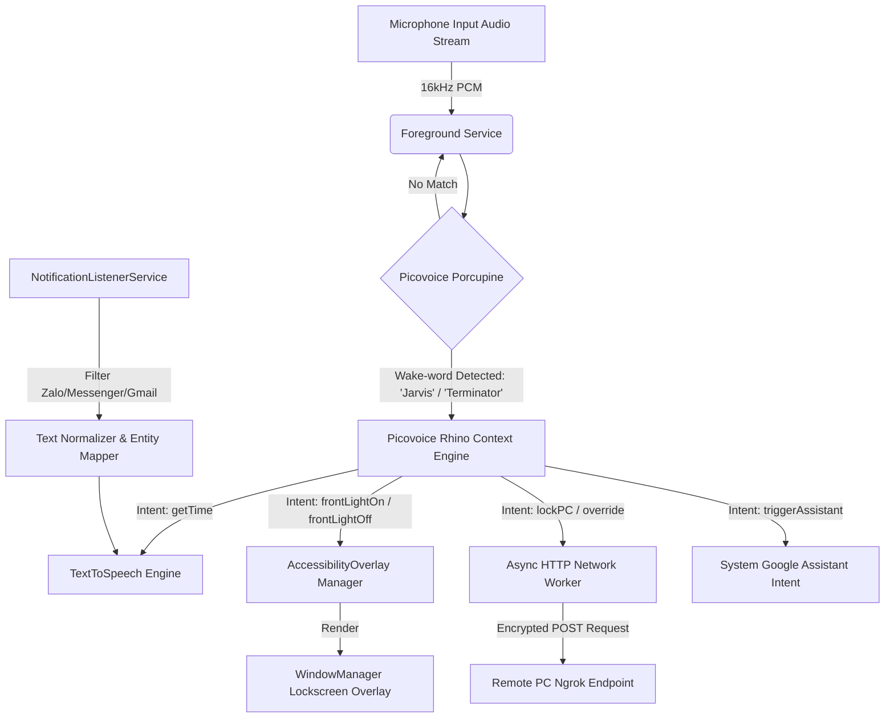

# 🤖 Jarvis Assistant - Edge AI Android Voice Control

[](https://kotlinlang.org/)
[](https://developer.android.com/)
[](https://picovoice.ai/)
[](#privacy--security-note)
[](LICENSE)

An advanced, lightweight, privacy-focused **Offline Edge AI Voice Assistant** engineered for Android. **Jarvis Assistant** leverages modern Android background services alongside low-latency on-device Speech Recognition engines (Picovoice Porcupine & Rhino) to perform local voice intent classification, system-level security overlay manipulation, multilingual notification synthesis, and remote PC control automation without relying on cloud audio streaming.

---

## 🌟 Key Highlights

* **100% On-Device & Privacy-First:** No voice recordings are ever uploaded to cloud servers. Audio processing happens entirely on the local device hardware.
* **Ultra-Low Latency Offline NLU:** Instant wake-word activation and intent recognition with near-zero latency using native C-bindings (`Porcupine` and `Rhino`).
* **Deep System-Level Automation:** Integrates `AccessibilityService` and `WindowManager` to render overlays above the Android lockscreen.
* **IoT & Remote PC Execution:** Asynchronously triggers custom security protocols on remote endpoints (e.g., PC lock/blackout sequences) via encrypted Ngrok tunnels.
* **Hybrid Multilingual TTS:** Intelligently parses incoming messaging app notifications (Zalo, Messenger, Gmail) and speaks them out loud in hybrid English-Vietnamese.

---

## 📐 System Architecture & Flow

The following sequence details how audio streams from `AudioRecord` flow into local AI engines and trigger system capabilities or remote endpoints:



---

## 🚀 Core Features Breakdown

### 1. Dual Wake-Word & Offline Intent Recognition
* **Wake Words:** Multi-keyword engine configured to respond to `"Jarvis"` and `"Terminator"`.
* **Rhino Context Engine:** Parses natural voice intents without internet connectivity:
  * *Time Queries:* `"What time is it?"`
  * *Optical Matrix (Front Light):* Controls high-brightness front illumination overlay layers with a built-in **60-second auto-safety timeout**.
  * *Security Override / Lockdown:* Triggers internal emergency UI panels and remote desktop lockdown sequences.
  * *Native Fallback:* Invokes system voice assistant seamlessly when necessary.

### 2. System-Level UI & Accessibility Overlays
* Employs `AccessibilityService` and `WindowManager.LayoutParams.TYPE_ACCESSIBILITY_OVERLAY` to draw high-priority neon security panels ("PNM Matrix") directly over secure Android lockscreens without unlocking the phone.

### 3. Remote PC Lockdown Sequence
* Sends asynchronous authenticated HTTP requests (`x-token` header verification) to remote PC servers running local Ngrok tunnels, enabling remote emergency desktop blackout/lock actions directly from your smartphone via voice command.

### 4. Smart Multilingual Notification Reader
* Uses `NotificationListenerService` to filter high-priority notifications (Zalo, Messenger, Gmail, System Alerts).
* Automatically cleans text formatting, normalizes accents, maps contact entities to designated relationship tags, and vocalizes alerts via hybrid English-Vietnamese Text-to-Speech (`SSML` enabled).

### 5. Battery & Memory Optimized Background Daemon
* Features a persistent Android **Foreground Service** with active status indicators in the system notification shade.
* Optimized audio buffers using native 16kHz PCM streams to prevent CPU throttle or device battery drain on modern MIUI / Android ROMs.

---

## 🛠️ Tech Stack

* **Language:** [Kotlin](https://kotlinlang.org/)
* **Platform:** Android SDK (API Level 26+)
* **Core Frameworks:** 
  * Android Service APIs (`ForegroundService`, `AccessibilityService`, `NotificationListenerService`)
  * `WindowManager` (System-Level Overlay Rendering)
  * `AudioRecord` (Low-level PCM Audio Streaming)
  * `TextToSpeech` (SSML Synthesis Engine)
* **Edge AI Engine:** 
  * [Picovoice Porcupine](https://picovoice.ai/platform/porcupine/) (On-Device Keyword Spotting)
  * [Picovoice Rhino](https://picovoice.ai/platform/rhino/) (On-Device Speech-to-Intent)
* **Networking & Tools:** `HttpURLConnection`, Ngrok Tunneling, Git.

---

## 💻 Getting Started & Configuration

### Prerequisites
1. [Android Studio Jellyfish | 2023.3.1](https://developer.android.com/studio) or newer.
2. Android Device running **Android 8.0 (API Level 26)** or higher.
3. A free **Picovoice Access Key** from [Picovoice Console](https://console.picovoice.ai/).

### Installation

1. **Clone the Repository:**
   ```bash
   git clone https://github.com/your-username/jarvis-android-edge-ai.git
   cd jarvis-android-edge-ai
   ```

2. **Configure Environment Secrets:**
   Create a `local.properties` file in the root directory (or open the existing one) and add your Picovoice Access Key:
   ```properties
   PICOVOICE_ACCESS_KEY=your_actual_picovoice_access_key_here
   ```

3. **Configure Remote PC Endpoint (Optional):**
   In `app/src/main/java/com/example/trolyao/AssistantService.kt`, update the PC endpoint configuration with your server credentials:
   ```kotlin
   private val PC_COMMAND_URL = "https://your-ngrok-tunnel-url.ngrok-free.dev/lockdown"
   private val AUTH_TOKEN = "YOUR_CUSTOM_SECURITY_TOKEN"
   ```

4. **Build and Install:**
   Connect your physical Android device with **USB Debugging** enabled and execute:
   ```bash
   ./gradlew installDebug
   ```

5. **Grant Device Permissions:**
   Upon launching the app, ensure you grant the required system permissions:
   * **Microphone Permission:** Required for local continuous wake-word listener.
   * **Accessibility Service:** Enable *Jarvis Assistant* under System Settings -> Accessibility.
   * **Notification Listener Access:** Allow notification access under System Settings -> Special App Access -> Notification Access.
   * **Display Over Other Apps:** Allow overlay drawing permissions.

---

## 🔒 Privacy & Security Note

This application was engineered with a strict **Privacy-First Architecture**:
* **Zero Cloud Audio Transmission:** All speech recognition processes (Porcupine wake-word & Rhino intent parser) execute natively inside local binary dependencies on your CPU.
* **Sensitive Data Protection:** API keys, remote URLs, and authentication tokens are kept isolated from the public repository via local system properties.

---

## 📄 License

This project is licensed under the MIT License - see the [LICENSE](LICENSE) file for details.

---

## 👨‍💻 Author

**Tien Dat**
* Portfolio / Resume Contact: phantiendat23022006@gmail.com / [LinkedIn](https://www.linkedin.com/in/phan-tiến-đạt-269a4436a)
* GitHub: [@tiendat2k6](https://github.com/tiendat2k6)
